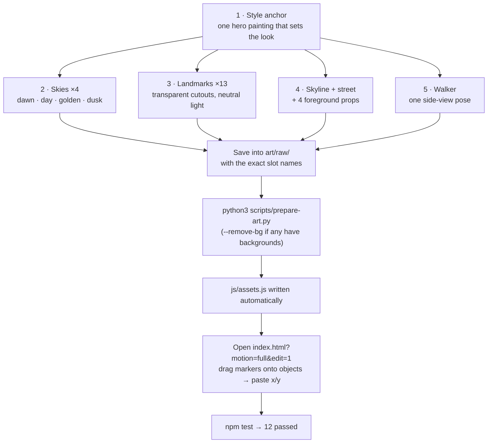

# Art Pack: Painted Rome with AI

The site now has a slot for every piece of art. When you drop in painted images, it layers them in parallax, re-lights them from dawn to dusk, adds haze, sun rays, and grain, and keeps every interaction working. This file covers what to generate, how to make 24 images look like one world, and how to get them into the site with one command.

---

## 1. The pipeline



**Order matters.** Make the style anchor first, then attach it as a reference to **every** later request. That one habit is the difference between "a world" and "24 unrelated AI images".

---

## 2. Rules that make it look expensive

1. **Use one model for everything.** Switching tools halfway breaks the look. If your tool can return a **transparent PNG**, ask for one. If it can't, generate on a plain flat background and let `prepare-art.py --remove-bg` cut it out.
2. **Paint landmarks in neutral midday light.** The site grades them warm at dawn, golden mid-walk, and dim violet at dusk. If golden hour is baked into a landmark, it will look wrong at the other stops.
3. **Light always comes from the upper left.** Every shadow falls down and to the right.
4. **Use the same camera every time:** a straight-on side elevation at eye level, as if you're standing across the street. Keep perspective minimal. This is what makes the parallax read as a real street.
5. **Landmark images contain no sky and no ground.** Only the building, plus a thin strip of paving under its base. The site supplies the sky, skyline, and street.
6. **Keep the scale consistent.** A person should stand about one sixth of the height of a large doorway. If one landmark comes out with giant or tiny details, regenerate it.
7. **Leave out text, signatures, tourists, cars, and modern signage.**

---

## 3. The style block (paste at the top of EVERY prompt)

```
STYLE: cinematic digital matte painting of Rome, painterly brushwork with crisp
architectural detail, warm travertine and honey-coloured stone, ochre and
terracotta accents, weathered surfaces, ivy and small plants in cracks, soft
ambient occlusion, gentle atmospheric softness, rich but natural colour, the
feeling of a hand-painted film backdrop. Light: soft neutral daylight from the
upper left. No text, no lettering except carved Roman inscriptions, no
watermark, no signature, no people unless described, no cars, no modern signs.
```

---

## 4. Step 1: the style anchor (not used in the site)

```
[STYLE BLOCK]
A wide cinematic painting of a Roman street at golden hour: a travertine
church facade on the left, an umbrella pine, a small piazza with a fountain,
cobblestones, distant domes in haze. Wide 16:9.
```
Generate until you love it, then save it as `style-anchor.png`. **Attach it to every later request** with: *"Match the painting style, brushwork, palette and level of detail of the attached image exactly."*

---

## 5. Skies (4 images) → `art/raw/sky-dawn.png`, `sky-day.png`, `sky-golden.png`, `sky-dusk.png`

Wide 16:9, **sky only**, with no land or buildings at all. Keep the bottom third soft and bright, because the skyline sits there.

```
[STYLE BLOCK]
Sky only, no land, no buildings, no horizon objects. A painted Roman sky at
[TIME]. The lower third fades into a soft bright horizon glow. Wide 16:9.
```
| File | `[TIME]` |
|---|---|
| `sky-dawn` | early dawn, cool lavender-blue above, peach and rose near the horizon, thin wispy clouds catching pink light |
| `sky-day` | late morning, clear warm blue, a few soft cumulus clouds, pale warm haze near the horizon |
| `sky-golden` | golden hour, deep blue above, amber and apricot near the horizon, clouds lit gold from below |
| `sky-dusk` | dusk after sunset, deep indigo above with first stars, a band of coral and burnt orange at the horizon |

---

## 6. Distant skyline → `art/raw/skyline.png`

```
[STYLE BLOCK]
A long, very wide strip of distant Roman rooftops seen far away in hazy
aerial perspective: several domes, two bell towers, terracotta roofs, umbrella
pines and dark cypresses, all low-contrast and softened by haze, blue-grey
and dusty mauve. Transparent background above the rooftops. The left and
right edges should continue naturally so the strip can repeat. Ultra-wide,
about 6:1.
```
Tip: if your tool can't do 6:1, generate at 16:9 twice and ask for "the continuation of this skyline to the right", then join the two side by side.

---

## 7. Street → `art/raw/street.png`

```
[STYLE BLOCK]
Front-on view of a Roman street surface: rows of dark grey sampietrini
cobblestones with warm dust in the gaps, a travertine kerb running along the
very top edge. Even lighting, no objects, no shadows of objects. Seamless
left-to-right. Wide 4:1.
```

---

## 8. Foreground props (4) → `art/raw/prop-lamp.png`, `prop-pine.png`, `prop-cypress.png`, `prop-bush.png`

These slide past in front of the walker. The site darkens and softly blurs them, like the out-of-focus foreground in a film shot.

```
[STYLE BLOCK]
[OBJECT], isolated, full height, standing on the bottom edge of the image,
side view, transparent background. Tall portrait 1:3 (lamp, pine, cypress)
or wide 2:1 (bush).
```
| File | `[OBJECT]` |
|---|---|
| `prop-lamp` | a Roman cast-iron street lamp, dark green-black, ornate base, single lantern at the top |
| `prop-pine` | an umbrella pine (Pinus pinea): tall bare trunk, flat wide canopy at the very top |
| `prop-cypress` | a tall slender Italian cypress |
| `prop-bush` | a low oleander bush with pink flowers |

---

## 9. The walker → `art/raw/walker.png`

This character is you. Replace the brackets with how you look.

```
[STYLE BLOCK]
Full-body character, side profile facing RIGHT, mid-stride walking pose,
isolated on a transparent background: a young woman with [hair], wearing
[outfit, e.g. a teal linen shirt, dark trousers, white sneakers] and carrying
[a brown leather satchel]. Friendly, relaxed posture. Same painterly style
as the attached image, slightly crisper edges so she reads at small size.
Tall portrait 1:2.
```
The site adds a walking bob and sway. For real leg movement, try an 8-frame sheet and name it `walker-sheet-8.png`: *"…a horizontal sprite sheet of 8 evenly spaced frames of one walk cycle, same character, same size, feet on the same baseline."* Most AI tools still struggle to keep 8 frames consistent, so the single pose is the safe choice.

---

## 10. Landmarks (13) → `art/raw/<id>.png`

Template for every landmark:
```
[STYLE BLOCK]
[SUBJECT]
Composition: straight-on side elevation at eye level, the whole structure in
frame with a small margin, its base sitting on a thin strip of paving on the
bottom edge. [ANCHORS]
Neutral soft daylight from the upper left. No sky, no background, no ground
beyond the base: transparent background. Wide 16:9.
```

**`[ANCHORS]` matter.** These are the objects the gold markers sit on. Positions are given as % from the left and % from the top. Get them roughly right, then fine-tune with the editor (§12).

| File | `[SUBJECT]` | `[ANCHORS]` |
|---|---|---|
| `popolo` | Porta del Popolo: the white travertine city gate with paired columns, attic and crest, a tall Egyptian obelisk on a pedestal to its right | Heavy wooden double doors **closed** in the central arch (≈50%, 75%). A wooden notice board with pinned papers on two posts at the far left (≈20%, 80%). Obelisk at ≈85%. |
| `popolo-open` | **Edit the popolo image** and ask for the same image with only the wooden doors swung fully open, showing a dim glimpse of the piazza through the arch | Everything else must stay pixel-identical. The site crossfades between the two. |
| `colosseum` | The Colosseum's outer facade, three tiers of arches and the attic, the right end broken and stepped down | Two gladiators with shield and spear at bottom-left (≈25%, 85%). A parchment scroll pinned to a pier (≈52%, 63%). A messenger with a leather bag at bottom-right (≈85%, 85%). |
| `aqueducts` | A run of 5 tall Roman aqueduct arches with the water channel on top; water spills from a spout at the right end into a stone basin | A worker sitting on top of the channel at the left (≈17%, 16%). The central arch (≈50%, 60%). Water and basin at bottom-right (≈93%, 86%). |
| `forum` | A Roman Forum temple ruin on a podium: exactly 4 tall columns carrying a fragment of entablature, broken stones and a column stump at left | The 4 columns at ≈29%, 42%, 56%, 69% (≈56% high). The entablature (≈50%, 24%). A small bronze bell hanging from a wooden post at right (≈89%, 60%). |
| `pantheon` | The Pantheon: portico of granite columns with triangular pediment and the carved inscription M·AGRIPPA, the great dome rising behind | The oculus opening visible at the top of the dome (≈57%, 9%). Tall bronze doors behind the columns (≈39%, 77%). Massive drum wall at right (≈86%, 70%). |
| `circus` | The Circus Maximus in its prime, side view: tiered stands behind a sand racetrack with a central spina and obelisk, the Palatine ruins beyond | Arched starting gates at far left (≈9%, 72%). One chariot with two horses on the track (≈70%, 87%). A coin purse on the stands (≈87%, 56%). |
| `vatican` | A grand archive hall shown as a cutaway: a huge arched opening revealing floor-to-ceiling bookshelves of old books and ledgers, St Peter's dome behind on the right | Shelves at left (≈25%, 66%). A shelf sealed with red cloth and a wax seal (≈50%, 81%). A wooden desk with an open ledger (≈69%, 84%). |
| `bocca` | The portico of Santa Maria in Cosmedin with its tall Romanesque bell tower on the left and the Bocca della Verità stone face mounted in the portico | The Mouth of Truth, large and clearly visible, with an open dark mouth (≈69%, 75%). |
| `capitoline` | Capitoline Hill: the Cordonata ramp of wide shallow steps leading up to the Palazzo Senatorio with its tower, balustrade at the top | A bronze statue of a scholar holding an open book on a pedestal at left (≈18%, 62%). Bronze balance scales on a pedestal at right (≈83%, 70%). |
| `spanish` | The Spanish Steps rising to Trinità dei Monti with its twin bell towers | 5 clear landings stacked from bottom to top (≈28%/94%, 62%/83%, 38%/72%, 62%/61%, 50%/50%). Terracotta pots of pink azaleas at the sides (≈83%, 88%). |
| `campo` | Campo de' Fiori market: 5 market stalls in a row with striped awnings (ochre, olive, blue, wine, rust) piled with produce and flowers, the hooded bronze statue of Giordano Bruno on the left | Stall centres at ≈32%, 47%, 61%, 76%, 90% (≈74% high). |
| `trevi` | The Trevi Fountain: the palace facade with the central triumphal arch and Oceanus in his niche, cascading rocks, the wide turquoise basin across the bottom | Open, calm water at the left front of the basin for the coin (≈22%, 88%). |

---

## 11. Prepare and wire everything (one command)

```bash
pip install pillow                     # once
pip install "rembg[cpu]"               # once, only if some images have backgrounds
python3 scripts/prepare-art.py         # or: python3 scripts/prepare-art.py --remove-bg
```
The script:
- checks every cutout really is transparent, and rejects full-frame pictures with a clear message
- trims empty space, fits each landmark into the 1800×1040 box with its base on the bottom edge, and keeps the open gate aligned with the closed one
- resizes skies, skyline, street, props, and walker, and exports compressed WebP
- **rewrites `js/assets.js`**, so nothing needs wiring by hand

You can do it gradually. Any slot you haven't made yet keeps its placeholder.

---

## 12. Put the markers on the objects

1. Open `index.html?motion=full&edit=1`.
2. Walk to each stop. All markers are visible and draggable.
3. Drag each gold marker onto its object, then click **Copy x/y for this stop**.
4. Paste the numbers over the matching `x:` and `y:` values in `js/data.js`.
5. Run `npm test`.

---

## 13. QA checklist for every image

- [ ] Transparent background (landmarks, skyline, props, walker)
- [ ] Base sits flat on the bottom edge
- [ ] Light from the upper left, neutral (not golden) for landmarks
- [ ] Same brushwork and palette as the style anchor
- [ ] Anchor objects present and roughly where the table says
- [ ] No text, logos, tourists, cars, or watermarks
- [ ] A person would be about one sixth of a doorway's height

---

## 14. What changes when a stop gets painted art

| Stop | Placeholder behaviour | With painted art |
|---|---|---|
| Porta del Popolo | Doors animate open | Crossfades to `popolo-open` (if provided) |
| Trevi | Coin arcs into the water | Unchanged: the coin and splash are drawn on top of your painting |
| Bocca | Jaw chomps | The painting gives a quick bite-shake |
| Vatican | Books fill the shelves | The painting glows; sources light up in the card |
| Aqueducts, Forum, Capitoline | Arches light, columns rise, scales tilt | The animation happens in the card only |

Everything else (walking, parallax, lighting, cards, games, journal, map, passport) works the same with painted art.

**Performance:** with all the art in, check `?debug=1`. If FPS drops below ~45 on an older laptop, `?fx=lite` switches off haze, rays, and grain.
