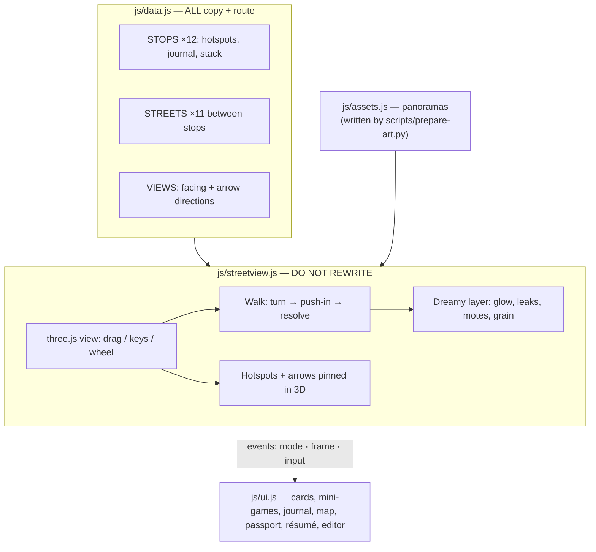

# Rome Walk: Guide

A first-person, Street View–style walk through Rome. You stand inside a view, drag to look around, and click the glowing arrows on the ground to walk. Each walk is a soft push-in with blur and bloom. 23 views (12 stops + 11 streets), all the cards and mini-games, journal, map, passport, and résumé view. Tested with 12 browser tests.

## 1. How it fits together



**Every change:** edit → `npm run check:copy` → `npm test` → look at it in the browser.

## 2. Run it

```bash
npm install
npx playwright install chromium      # once, for tests
npm run serve                        # http://localhost:8765
npm test                             # copy check + 12 browser tests (a few minutes)
```
Use `npm run serve`. Real panoramas won't load from a double-clicked `index.html`.

| URL flag | Does |
|---|---|
| `?edit=1` | View editor: set facing and arrows, drag markers, copy the snippet |
| `?debug=1` | Shows the view id, yaw, pitch, FOV, FPS, and whether the view is a placeholder |
| `?motion=full` / `?motion=reduced` | Force full motion or calm crossfades (a Mac with Reduce Motion on gets the calm version) |
| `?fx=lite` | Turns off light leaks, dust, and grain for slow machines |
| `?skipintro=1` · `#resume` | Skip the intro · open the résumé directly |

## 3. Files

| File | What | Edit? |
|---|---|---|
| `js/data.js` | All copy, stops, hotspots, streets, `VIEWS` | ✅ |
| `js/assets.js` | Panorama list | ✅ via `prepare-art.py` only |
| `js/streetview.js` | The walk engine | ❌ |
| `js/ui.js` | Cards, widgets, journal, map, passport, résumé, editor | ✅ for new widgets |
| `css/styles.css` | All styles | ✅ |
| `vendor/three.min.js` | three.js r128 (bundled, works offline) | ❌ |
| `scripts/prepare-art.py` | Raw images → `art/panos/` + `js/assets.js` | ❌ just run it |
| `scripts/check-copy.js`, `tests/` | Budgets + acceptance tests | ❌ never weaken |
| `PANORAMA_PROMPTS.md` | Prompts for all 23 views | ✅ |

## 4. Hard rules (also in `.cursor/rules/rome-walk.mdc`)

1. Never rewrite `streetview.js`, and never turn the walk into a slideshow, side-scroller, or scrolling page.
2. Nothing with a background covers more than a quarter of the view. Long text lives only in the journal and résumé.
3. Text budgets: label ≤10 words, tooltip ≤4, card title ≤6, card body ≤35, journal ≤120.
4. Art enters only through `scripts/prepare-art.py`.
5. `npm test` must pass, and tests are never edited to pass.

## 5. Common tasks

- **Add the panoramas:** follow `PANORAMA_PROMPTS.md`. Save to `art/raw/<view-id>.jpg`, run `python3 scripts/prepare-art.py`, then use `?edit=1`.
- **Change text:** edit `js/data.js`, then `npm run check:copy`.
- **Add GitHub repos:** add `repos: [{ name, url, description }]` to a stop's `journal` in `js/data.js`.
- **Walk stop to stop only:** set `Rome.SHOW_STREETS = false` in `js/data.js`.
- **Deploy:** it's a static site. Drag the folder into Netlify or Vercel (no build command), or push to GitHub Pages. Skip `node_modules/` and `art/raw/`.
- **Commit before every Cursor session:** `git add . && git commit -m "before cursor"`.

## 6. Prompts for Cursor

**Start of every chat:**
```
Read CURSOR_GUIDE.md and .cursor/rules/rome-walk.mdc. This is a working, tested site. Do not rebuild or restructure it. Run `npm test` and report the result before changing anything.
```
**New panoramas:**
```
I added images to art/raw/. Run `python3 scripts/prepare-art.py`. Do not edit js/assets.js or js/streetview.js. Then run npm test and paste the summary.
```
**If Cursor starts rebuilding things:**
```
Stop. Revert everything except js/data.js, css/styles.css and art/. Re-read .cursor/rules/rome-walk.mdc. Now do only: [task].
```
