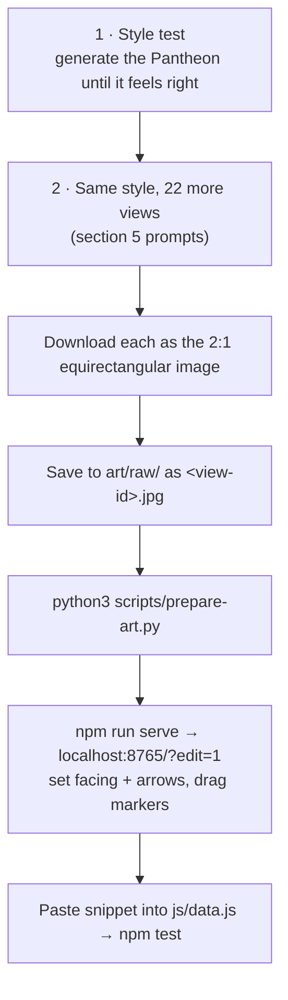

# Panorama Pack: a dreamy walk through Rome

The site is a first-person walk through **23 views**: 12 landmark stops plus 11 streets between them. Each view is one image you stand inside and look around. The images carry the look, and everything else (walking, glow, dust motes, titles, cards) is already built.

## 1. The pipeline



## 2. The tool: Blockade Labs Skybox AI

Skybox AI generates **360° panoramas** from a text prompt. That is exactly what a Street View–style walk needs, because you can turn all the way round inside each image. Download the **equirectangular** file (the 2:1 image) at the highest resolution your plan allows; the script downsizes to 4096×2048.

**If you'd rather use your usual image tool:** ask it for a very wide 21:9 first-person street photo instead. The script detects it and it works, but you can only look a little way left and right within its edges. Mixing the two is fine.

## 3. What makes it dreamy instead of "AI tour"

1. **Stand at eye level on the street,** as if you're a visitor. No aerial or drone views.
2. **Put the landmark in the centre of the panorama.** The centre of the image is where you face on arrival (fixable later in `?edit=1`).
3. **Keep the streets empty and quiet.** At most one or two distant figures, no crowds, cars, or tourists.
4. **Match the time of day to the walk.** The route goes dawn → morning → golden hour → dusk (see the table), so the day passes as you walk.
5. **Use the same style line in every prompt** (section 4) so the 23 views feel like one memory.
6. **In street views, keep the street running straight ahead,** where the "walk on" arrow sits.

## 4. The style line (end EVERY prompt with this)

```
Dreamlike painterly realism, soft luminous haze, gentle bloom on highlights,
warm travertine and honey stone, pastel sky, glowing air, delicate film grain,
calm and empty streets, a romantic memory of Rome, eye-level view from the
street, highly detailed, no text, no people in the foreground, no cars.
```

## 5. All 23 views (in walking order)

| # | Save as | Light | Prompt (then add the style line) |
|---|---|---|---|
| 1 | `popolo.jpg` | early dawn, rose and lavender | Standing in Piazza del Popolo facing the Porta del Popolo city gate, the tall Egyptian obelisk and fountain lions nearby, twin domed churches behind you, dew on the cobblestones |
| 2 | `via-del-corso.jpg` | dawn turning golden | Walking down a long straight Via del Corso, tall ochre palazzi with green shutters, iron balconies, the street stretching ahead into morning haze |
| 3 | `colosseum.jpg` | soft morning | Standing on the paved square in front of the Colosseum, its arches rising ahead, umbrella pines and the Arch of Constantine to one side |
| 4 | `via-appia.jpg` | bright hazy morning | On the ancient Via Appia Antica: large worn paving stones, tall cypresses and umbrella pines lining the road, ruined tombs in the grass, road continuing ahead |
| 5 | `aqueducts.jpg` | warm late morning | In the Parco degli Acquedotti meadow, a long line of ancient aqueduct arches ahead, wildflowers in the grass, a path along them |
| 6 | `fori-imperiali.jpg` | late morning | On Via dei Fori Imperiali, ruins of the imperial forums on both sides below railings, the Vittoriano far ahead, pines along the avenue |
| 7 | `forum.jpg` | midday, softened | Standing among the Roman Forum ruins facing the Temple of Saturn's columns, broken marble, arches in the distance, grass between stones |
| 8 | `via-del-seminario.jpg` | early afternoon | A narrow cobbled lane in the centro storico, warm plaster walls, ivy and flower pots, laundry high above, opening to a piazza ahead |
| 9 | `pantheon.jpg` | early afternoon glow | Standing in Piazza della Rotonda facing the Pantheon portico and dome, the fountain with its small obelisk nearby, empty café chairs |
| 10 | `via-dei-cerchi.jpg` | afternoon | On Via dei Cerchi beside the long green hollow of the Circus Maximus, Palatine ruins rising on the right, pines, the road curving ahead |
| 11 | `circus.jpg` | warm afternoon | Standing at the edge of the Circus Maximus valley, the long grassy racetrack stretching ahead, Palatine palace ruins above it |
| 12 | `ponte-sant-angelo.jpg` | early golden hour | Standing on Ponte Sant'Angelo among the marble angel statues, Castel Sant'Angelo ahead, the Tiber below reflecting gold |
| 13 | `vatican.jpg` | golden hour | Standing in St Peter's Square facing the basilica and dome, the curving colonnades embracing the square, the obelisk in the centre |
| 14 | `lungotevere.jpg` | deep golden hour | Walking along the Lungotevere under plane trees, the stone river wall, the Tiber and a bridge in soft glowing light |
| 15 | `bocca.jpg` | golden hour | In front of Santa Maria in Cosmedin, its tall Romanesque bell tower, the portico ahead with the round Bocca della Verità stone face visible inside |
| 16 | `teatro-marcello.jpg` | late golden hour | Beside the Theatre of Marcellus, its ancient curved arches glowing, columns of the Temple of Apollo in front, road continuing ahead |
| 17 | `capitoline.jpg` | sunset beginning | At the foot of Michelangelo's Cordonata ramp leading up to the Capitoline piazza, the Dioscuri statues at the top, the Palazzo Senatorio tower beyond |
| 18 | `via-condotti.jpg` | sunset | Walking up Via dei Condotti, elegant palazzi on both sides, the Spanish Steps and twin bell towers glowing at the end of the street |
| 19 | `spanish.jpg` | sunset, pink sky | Standing at the foot of the Spanish Steps by the Barcaccia fountain, the steps rising to Trinità dei Monti, pink azaleas on the steps |
| 20 | `via-giubbonari.jpg` | early dusk | A narrow lane of small shops with warm lit windows, cobbles, strings of lights switching on, a square opening ahead |
| 21 | `campo.jpg` | dusk, warm lamps | In Campo de' Fiori, market stalls under striped awnings closing up, the hooded bronze Giordano Bruno statue, warm lamplight |
| 22 | `via-delle-muratte.jpg` | blue hour | A quiet lane glowing with lanterns, the edge of the Trevi Fountain appearing at the end |
| 23 | `trevi.jpg` | blue hour, fountain lit | Standing at the Trevi Fountain's edge, the glowing turquoise basin, Oceanus and the palace facade lit warmly, the first stars above |

**Smaller first version:** make only the 12 stops and set `Rome.SHOW_STREETS = false` in `js/data.js`. You'll walk stop to stop, and can add the streets later.

## 6. Bring them in

```bash
pip install pillow                       # once
python3 scripts/prepare-art.py           # sizes, compresses, writes js/assets.js
npm run serve                            # then open http://localhost:8765
```
Panoramas only load from a local server (`npm run serve`) or a real host, not by double-clicking `index.html`. That's a browser security rule for WebGL images.

## 7. Point everything the right way (`?edit=1`)

Open `http://localhost:8765/?edit=1` and, at each view:

1. Look at the landmark and click **Face here on arrival**.
2. Look down the path onward and click **Forward arrow here**. Look back the way you came and click **Back arrow here**.
3. At stops, drag each gold marker onto its object (the gladiators, the oculus, the coin spot…).
4. Click **Copy snippet** and paste it into `js/data.js`. The `Rome.VIEWS` line goes into `Rome.VIEWS`, and the hotspot `yaw`/`pitch` values go onto the matching hotspots.
5. Run `npm test`.

## 8. QA checklist for each view

- [ ] A true 2:1 panorama (or 21:9 wide image)
- [ ] Eye level on the street, landmark near the centre
- [ ] Light matches its row in the table
- [ ] Empty, quiet streets with no cars, crowds, or text
- [ ] The path onward is visible for the forward arrow
- [ ] It feels like the same dream as the Pantheon test
